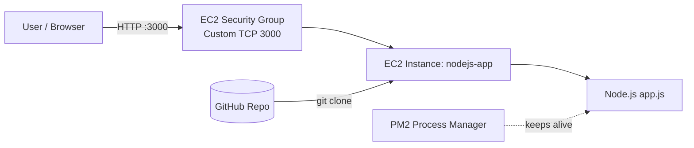

# Nodejs-app

A dynamic Node.js application deployed on an AWS EC2 instance, served on **port 3000** and kept running in the background with **PM2**.

---

## Introduction

This project shows how to take a Node.js app from GitHub and run it on a Linux server (Amazon Linux EC2):

1. Install Node.js, npm and Git
2. Clone the repository
3. Install dependencies and run `node app.js`
4. Keep it running in the background with PM2

---

## Architecture Diagram



---

## Prerequisites

- An AWS account with a running EC2 instance (named `nodejs-app`)
- Security Group inbound rule: **Custom TCP, port 3000**
- SSH access to the instance

---

## Installation and Setup

**1. Connect to the EC2 instance using SSH**

```bash
ssh -i your-key.pem ec2-user@<EC2-PUBLIC-IP>
```

**2. Update the system and install Git and Node.js**

```bash
sudo yum update -y
sudo yum install git nodejs -y
```

**3. Verify the installation**

```bash
node --version
npm --version
git --version
```

**4. Clone the repository**

```bash
git clone https://github.com/Vishal32-stack/Nodejs-app.git
cd Nodejs-app
ls
```

You should see `app.js` and `package.json`.

**5. Install dependencies**

```bash
npm install
```

This creates the `node_modules` folder and `package-lock.json`.

**6. Run the application**

```bash
node app.js
```

> Pressing `Ctrl + C` stops the app. To keep it running after you close the terminal, use PM2 (see below).

---

## Input

- A browser request to the server's public IP on port 3000.

```
http://<3.84.223.169>:3000
```

---

## Output

- The response served by `app.js` appears in the browser at:

```
http://<3.84.223.169>:3000
```


---

## Background Run with PM2

PM2 keeps the app running after you close the terminal and restarts it if it crashes.

```bash
sudo npm install -g pm2
sudo pm2 start app.js
```

Useful PM2 commands:

```bash
sudo pm2 list          # show running apps
sudo pm2 logs          # view logs
sudo pm2 restart app   # restart the app
sudo pm2 stop app      # stop the app
```

---

## Conclusion

The Node.js application was deployed on an AWS EC2 instance, exposed on port 3000 through the Security Group, and configured with PM2 so it keeps running in the background without an open terminal.

---

## Author

**Vishal** — [GitHub: Vishal32-stack](https://github.com/Vishal32-stack)
